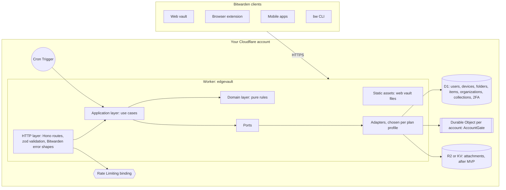
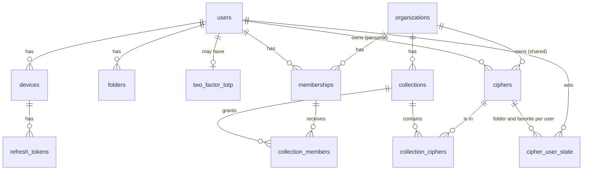
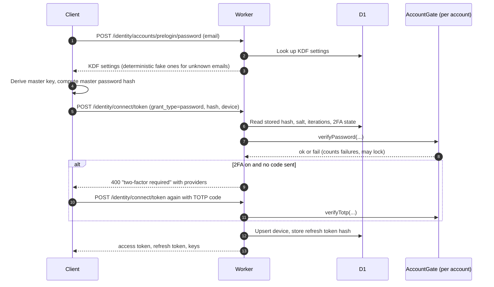

# 02. Architecture

## Summary

edgevault is **one Cloudflare Worker**. The Bitwarden apps talk to it over HTTPS.

- The Worker keeps all accounts, vault items, organizations, and settings in a **D1** database.
- For each account, it uses a small **Durable Object** (called the *account gate*). The gate checks passwords and 2FA codes and slows down anyone who guesses wrong too often. On the Free plan it also does the expensive password hashing, because a normal Free-plan request is only allowed 10 ms of CPU and hashing takes about 100 ms.
- Attachments, once added, go to **R2** (or **KV** without a card).
- The same Worker also serves the Bitwarden web vault as static files.

Inside the Worker, the code is split into layers so that the business rules do not depend on Cloudflare. That keeps them easy to test, and it lets the same rules run on the Free and Paid plans with different plumbing underneath.

Everything sensitive arrives already encrypted by the apps. The server stores it and enforces who may read or change what.

## Constraints that shape the design

These come from the Cloudflare docs (checked November 2026) and from the [design-phase POCs](spikes/2026-11-design-pocs.md).

| Constraint | Workers Free | Workers Paid | Consequence |
|---|---|---|---|
| CPU time per request | 10 ms | 30 s default, up to 5 min | Server-side password hashing (about 100 ms measured locally) cannot run in a Free-plan Worker |
| Requests per day | 100,000 | no limit | Fine for a family |
| Subrequests (including D1 queries) per request | 50 | 10,000 (D1: 1,000) | Use `db.batch()`; a batch counts as one query |
| D1 database size | 500 MB | 10 GB | Fine for a family |
| D1 rows read per day | 5 million | monthly allowance | Indexed queries; sync reads about one row per visible item |
| D1 rows written per day | 100,000 | monthly allowance | Watch write amplification, such as revision dates for every organization member |
| D1 row size | 2,000,000 bytes | same | Cap encrypted item size below this |
| D1 bound parameters per statement | 100 | same | Chunk bulk inserts |
| D1 Time Travel | 7 days | 30 days | Free-plan backup story |
| Durable Objects | SQLite-backed only | SQLite-backed | Use SQLite-backed classes only |
| Durable Object CPU per request | 30 s | 30 s default, up to 5 min | Hashing can move here on Free |
| Durable Object requests and compute | 100,000 requests and 13,000 GB-s per day; operations fail past either | 1 million requests per month included, then metered | At most two calls per login; budget test |
| R2 | own free allowance (10 GB); needs a card | same | Default attachment store ([ADR 0007](adr/0007-attachment-storage.md)) |
| KV | 1 GB, 25 MiB per value, 1,000 writes per day | larger | No-card attachment store |
| Email sending | only to verified addresses in your account | any recipient (3,000 per month included) | Organizations must work without email |

Assumptions still to be settled by M0 spikes (see [05-delivery-plan.md](05-delivery-plan.md)):

- Hosted CPU time of hashing and sync on a real Free account (local measurement done).
- Whether the Rate Limiting binding is available on Free.
- Which "V2" account features current clients require.
- The exact organization and two-factor request shapes, from captured client traffic.

## Shape of the system

Requests to `/api/*` and `/identity/*` go to the code; everything else is served from the web vault's static files.

### Layer rules

1. The domain layer imports nothing from Cloudflare, Hono, or `fetch`. It is plain functions and types, so it runs in any test runner.
2. Application use cases depend only on ports. Each use case is one file with one exported function.
3. Adapters implement ports. There is one adapter per port per backing service. Adapters contain no business rules.
4. Only `src/composition/` knows which adapter goes with which plan profile or attachment backend.
5. A dependency-cruiser rule in CI enforces rules 1 to 4.

### Repository layout (target)

| Path | Contents |
|---|---|
| `src/domain/` | Pure rules: KDF policy, EncString validation, revision dates, item types, organization access rules, TOTP verification |
| `src/application/` | Use cases, one file each |
| `src/ports/` | Interfaces |
| `src/adapters/d1/` | D1 implementations of the stores, and the Drizzle schema |
| `src/adapters/do/` | Durable Object classes (`AccountGate`, later a notifier for live sync) |
| `src/adapters/webcrypto/` | Hashing, token signing, TOTP, secret encryption |
| `src/adapters/blob/` | R2 and KV attachment stores (after MVP) |
| `src/http/` | Hono routes, request validation, Bitwarden error shapes |
| `src/composition/` | Wires adapters per profile |
| `specs/` | Test data: scenario files and tables ([04-testing-strategy.md](04-testing-strategy.md)) |
| `test/runner/` | Scenario parser, printers, runners |
| `test/unit/` | Tests better written as code |
| `migrations/` | D1 SQL migrations |

## Plan profiles

A profile is a set of adapter choices, not `if (isFree)` branches. The domain and application layers never see it. It is set with `PLAN_PROFILE=free|paid` in the Wrangler config (default `free`).

| Concern | `free` profile | `paid` profile |
|---|---|---|
| Server-side password hash | In the `AccountGate` Durable Object (30 s CPU budget) | Inline in the Worker with `limits.cpu_ms` raised |
| Strict login and 2FA throttle | `AccountGate` | `AccountGate` (same) |
| Bulk import | Chunked batches within 50 queries and 100 bound parameters | Same code, larger chunks |
| Coarse rate limit on registration and prelogin | Rate Limiting binding; fallback is a Durable Object counter | Rate Limiting binding |
| Email (optional) | Only to verified addresses in your account | Any recipient |
| Scheduled cleanup | One Cron Trigger | Same |
| Backups | D1 Time Travel (7 days), plus optional export | Time Travel (30 days), plus export |

The attachment backend (R2 or KV) is a **separate** setting, because it depends on whether the account has a card, not on the Workers plan ([ADR 0007](adr/0007-attachment-storage.md)).

Each pair of adapters shares one contract test file, so they cannot drift ([ADR 0003](adr/0003-plan-profiles-via-adapters.md)).

### Account gate (Durable Object)

One SQLite-backed Durable Object per account, named from an HMAC of the normalized email so the id does not reveal the address. It holds only counters, lockout timestamps, and the last accepted TOTP time step. Credentials stay in D1; the Worker reads the stored hash from D1 and passes it in. Unknown emails go to a fixed set of shared objects that do the same work against a dummy hash ([ADR 0005](adr/0005-per-account-durable-object.md)).

## Data model (D1)

All vault content is ciphertext produced by the clients. The server stores it and validates only its shape.

| Table | Key columns | Notes |
|---|---|---|
| `users` | `id`, `email` (unique, lowercased), `name`, `password_hash`, `password_salt`, `password_iterations`, client KDF settings, `encrypted_user_key`, `public_key`, `encrypted_private_key`, `security_stamp`, `revision_date` | Fields for "V2" accounts are added if M0 shows clients need them |
| `devices` | `id`, `user_id`, `device_identifier`, `name`, `type`, `last_seen_at` | Unique per user and identifier |
| `refresh_tokens` | `token_hash`, `device_id`, `expires_at` | Only the SHA-256 of the token |
| `two_factor_totp` | `user_id`, `encrypted_secret` (AES-GCM, key in Workers Secrets), `enabled`, `recovery_code_hash` | [ADR 0009](adr/0009-totp.md) |
| `folders` | `id`, `user_id`, `name` (EncString) | |
| `ciphers` | `id`, either `user_id` or `organization_id` (exactly one, `CHECK`), `type`, `data` (JSON of EncStrings, size-capped), `deleted_at`, timestamps | |
| `cipher_user_state` | `cipher_id`, `user_id`, `folder_id`, `favorite` | Folders and favorites are personal, even for shared items |
| `organizations` | `id`, `name`, `billing_email`, `public_key`, `encrypted_private_key`, `revision_date` | [ADR 0008](adr/0008-organizations.md) |
| `memberships` | `id`, `organization_id`, `user_id` (null until accepted), `email`, `status`, `role`, `access_all`, `encrypted_org_key` (null until confirmed) | |
| `collections` | `id`, `organization_id`, `name` (EncString) | |
| `collection_members` | `collection_id`, `membership_id`, `read_only`, `hide_passwords`, `manage` | |
| `collection_ciphers` | `collection_id`, `cipher_id` | |

Design notes:

- Every column used for filtering has an index; budget tests check rows read.
- No audit-log table in the MVP, because each extra write spends the Free write allowance.
- `ciphers.data` is capped below D1's 2,000,000-byte row limit, with a clear Bitwarden-shaped error.
- Tables are defined once in a Drizzle schema. Queries go through Drizzle's query builder; sync and the organization access checks are reviewed SQL written with Drizzle's parameterized `sql` template ([ADR 0010](adr/0010-drizzle-for-d1.md)).
- Migrations are SQL files generated by `drizzle-kit`, reviewed, and applied by `wrangler d1 migrations apply`. They are always additive. The Worker never creates schema at request time.

## Authentication

- The client derives keys and sends a **master password hash**. The server never sees the master password.
- The server stores a second, server-side hash of that value. The iteration count is stored per user, and the hash is upgraded on the next successful login when the configured count rises.
- Login supports the `password` and `refresh_token` grants.
- Tokens: HMAC-signed access tokens with a purpose claim, random refresh tokens stored as hashes and rotated on use ([ADR 0006](adr/0006-token-signing.md)). Changing the password or deauthorizing sessions changes the security stamp, which invalidates existing tokens.
- **Account existence is not revealed.** For an unknown email, prelogin returns KDF settings picked deterministically from a short list of common settings by a keyed hash of the email. Login for an unknown email does the same work against a dummy hash.
- **TOTP second factor:** checked in the account gate, with replay protection and throttling ([ADR 0009](adr/0009-totp.md)).
- Secret comparisons use `crypto.subtle.timingSafeEqual`.
- Secrets (`JWT_SIGNING_KEY`, `EMAIL_HMAC_KEY`, `TOTP_ENCRYPTION_KEY`) are Workers Secrets, never in config, logs, or test data.

## Organizations

Covered in [ADR 0008](adr/0008-organizations.md). In short: the clients create and share the organization key, encrypted for each member's public key. The server stores only ciphertext and enforces, on every request, which member may see or change which collection and item. These access rules are the security boundary for sharing in a family, and they are specified as a table of scenarios (every role against every action).

## Sync

`GET /api/sync` returns the profile, folders, personal and shared items, collections, organizations, and policies in one response.

- **Query count:** about 6 per sync (profile, memberships, collections, personal items, shared items, folder and favorite state), well under 50 on Free.
- **Rows read:** about one per visible item, plus one per membership and collection, because every filter is indexed. A budget test asserts this.
- `GET /api/accounts/revision-date` is polled often by clients, so it is a single indexed read. Changes to shared items bump the revision date of every member who can see them.
- The response includes `premium: true`, so the apps show TOTP codes stored in items.

## Errors

Bitwarden clients parse specific error bodies, for example `{"message": "...", "validationErrors": {...}}` and OAuth-style errors from the token endpoint. Error shapes are part of the scenarios and are checked against the oracle ([04-testing-strategy.md](04-testing-strategy.md#validating-the-tests)).

## Observability and privacy

- Workers Logs and Traces, structured JSON. A log helper redacts tokens, hashes, email addresses, 2FA codes, and anything under `data`.
- No vault content, ciphertext, or key material in logs, metrics, or error reports.
- Throttling and lockouts are logged as events.
- Nightly staging jobs record CPU and wall time from invocation logs.

## Security checklist (design-level)

- Secrets only in Workers Secrets, CI secrets, or `.dev.vars` (git-ignored).
- Input validated at the HTTP boundary with zod; domain functions re-check invariants.
- Parameterized statements only; a Semgrep rule forbids `sql.raw()` and string-built SQL.
- Strict per-account throttle for passwords and 2FA codes; coarse Rate Limiting binding on registration and prelogin.
- Organization access rules checked on every request, specified as a reviewed scenario table.
- Registration closed after the first user unless a config flag opens it. Organization invites work without opening registration to everyone: an invited email may register.
- Dependency audit and secret scanning in CI.
- [THREAT_MODEL.md](../THREAT_MODEL.md) and [SECURITY.md](../SECURITY.md) are kept current; changes that hit a review trigger update them in the same PR.
- The [Cloudflare practices checklist](08-cloudflare-practices.md) is enforced by CI where possible.

## Deployment

- `wrangler.jsonc` declares the Worker, D1, Durable Object, R2 or KV bindings, static assets, the cron trigger, observability, source maps, `nodejs_compat`, `PLAN_PROFILE`, and `ATTACHMENTS_BACKEND`. Bindings are declared per environment, and deploys always pass `--env`.
- D1 migrations are applied by database name before the new code goes live, and are additive, so two Worker versions can run together.
- GitHub Actions deploys staging on merge to `main` and production on a tag.
- A "deploy to your own account" guide uses only `wrangler` and a few secrets.
