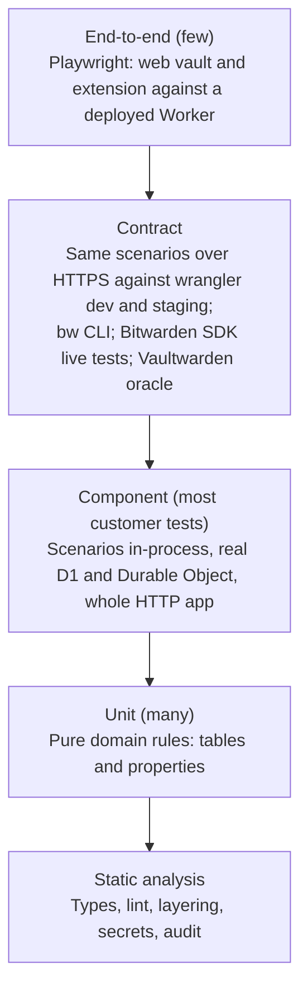
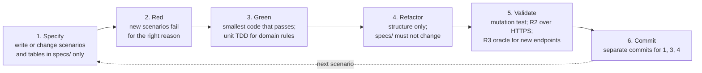

# 04. Testing strategy

## Summary

We write the tests **before** the code, and the tests are the real specification.

- Most tests are short, readable **scenario files**: "given Alice has these items, when she trashes one, then her vault looks like this". A small program reads these files and runs them against the server. The files are easy to review, and a coding agent cannot quietly weaken them.
- Tests follow a **pyramid**: many fast checks of small rules at the bottom, fewer broader tests in the middle, and a few slow browser tests at the top.
- Tests run against **real** Cloudflare pieces (D1, Durable Objects) inside the Workers runtime instead of fakes, and the same scenarios also run against a real deployed Worker and a reference server.
- We check the tests themselves: by injecting bugs (mutation testing), by comparing with a reference server (Vaultwarden), by using official test data (the TOTP standard's test vectors and Bitwarden's SDK tests), and by random inputs (property-based tests).
- The Free plan's limits (rows, queries, CPU) are tests too.

This document is the workflow guideline for every change.

It follows two sources:

- ["Tests as data"](https://martinfowler.com/articles/tests-as-data.html) on martinfowler.com (2026): customer tests, black-box tests, tests-as-data, test DSLs, protecting the test harness, validating the tests. The design below was written after reading that page in full.
- The test pyramid: many fast, narrow tests at the bottom, few slow, broad tests at the top. See [The Practical Test Pyramid](https://martinfowler.com/articles/practical-test-pyramid.html). That page was not re-read for this design, so the proportions below are our own targets, not quotations.

## Principles

1. **The specification is executable.** Behavior is written as scenario files that run in CI. Prose docs describe intent. Scenarios describe truth.
2. **Customer tests first.** For this project, the "customer" is a Bitwarden client and the person self-hosting. Scenarios are written in their terms: "register, log in, add an item, see it on the second device".
3. **Black box.** Scenarios talk to the system through its HTTP interface and through readable projections of its stored state. They never mention classes, functions, or table internals beyond a printed projection.
4. **Real dependencies over mocks.** The in-process runner uses a real D1 and a real Durable Object inside the Workers runtime, through `@cloudflare/vitest-plugin` (the renamed, current version of `@cloudflare/vitest-pool-workers`, which is deprecated). We do not mock `StorageService`-style collaborators, because mock-heavy tests prove "function A calls function B", not "input X gives output Y".
5. **Tests are protected.** Test data, test runner, and production code change for different reasons and are guarded separately (see [Protecting the harness](#protecting-the-harness)).
6. **Tests are themselves validated** by mutation testing, an external oracle, and property-based tests (see [Validating the tests](#validating-the-tests)).

## The pyramid for this project

Read from top (few, slow, broad) to bottom (many, fast, narrow):



| Level | What it proves | Runs | Speed target | Share of test cases (target) |
|---|---|---|---|---|
| Static | Types, layering, no string-built SQL, no secrets, dependency audit | every commit | seconds | not counted |
| Unit | Pure domain rules: EncString shape, KDF policy, revision date rules, size caps, token claims, organization access rules, TOTP verification | every commit | under 10 s total | about 60% |
| Component (scenarios, in-process) | End-to-end behavior of the whole Worker app with real D1 and Durable Object, no network | every commit | under 60 s total | about 30% |
| Contract | The same scenarios over real HTTP against `wrangler dev` and a staging Worker; official `bw` CLI; Bitwarden SDK live tests | every PR (local runner), nightly (staging, latest clients) | minutes | about 8% |
| End-to-end (browser) | The pinned web vault and a browser extension talk to a deployed Worker | nightly and before release | minutes | about 2% |
| Exploratory (human) | Things nobody thought to specify | before each release | n/a | n/a |

The percentages are targets to keep the shape of a pyramid. CI prints the actual counts per level. A level growing past its target is a review comment, not a build failure.

Rules of thumb:

- If a behavior can be proven at a lower level, do not also prove it higher up.
- A bug found at a higher level gets a regression test at the lowest level that can catch it.
- E2E tests check that the pieces connect. They do not re-test business rules.

## Tests as data

Most tests are **scenario files** in `specs/`. A scenario has three parts, as in the article's Approved Scenarios pattern: setup, action, and the expected state afterwards.

### Scenario format

Scenarios are Markdown files with fixed keywords, parsed by our own parser (an external DSL). The Markdown makes them readable on GitHub and gives clean diffs.

```markdown
# specs/vault/trash-and-restore.scenario.md

## Trashing an item removes it from the active vault and keeps it recoverable
id: vault.trash.001
covers: PUT /api/ciphers/{id}/delete, GET /api/sync

GIVEN account: alice@example.com
GIVEN vault of alice:
  folder "Work"
  login "GitHub" in "Work"
  login "Bank"
WHEN alice on device "chrome" requests:
  PUT /api/ciphers/{GitHub}/delete
THEN response: 200
THEN sync of alice on device "chrome":
  folder "Work"
  login "GitHub" in "Work" [trashed]
  login "Bank"
THEN revision date of alice: changed
```

How to read it:

- Names in `"quotes"` are test-friendly labels. Real ciphertext and ids are generated by a **test client** that uses real Bitwarden crypto (with test vectors from the Bitwarden SDK) so the server stores realistic data.
- `{GitHub}` is replaced by the generated id of the item labelled "GitHub".
- The `THEN sync ...` and `THEN vault ...` lines are **printers** (the article's term). They turn JSON and stored ciphertext into short, stable text by decrypting with the test user's key. A failing test shows a plain text diff of expected versus actual vault.
- Tables handle the many scalar cases, as in the article's CSV example:

```csv
# specs/accounts/prelogin.table.csv
case,client,email,registered,expect_status,expect_kdf,expect_iterations
known email gets its own settings,web 2026.10,alice@example.com,yes (argon2id 3 iter),200,argon2id,3
unknown email gets settings from the common list,web 2026.10,nobody@example.com,no,200,one-of-common-list,
unknown email gets the same answer twice,web 2026.10,nobody@example.com,no,200,same-as-previous-row,
malformed email is rejected,web 2026.10,not-an-email,no,400,,
```

(Values are examples. M0 verifies them against the oracle. The `client` column lets the same behavior be specified per client version; see [03-api-surface.md](03-api-surface.md#client-version-differences).)

### Example: organization access table

Sharing within a family is only safe if the server's access checks are right, so they are one big reviewed table: every role against every action.

```csv
# specs/organizations/access.table.csv
case,actor,actor_state,action,target,expect
owner can delete the organization,alice,owner confirmed,delete organization,Smith Family,allowed
user cannot delete the organization,bob,user confirmed,delete organization,Smith Family,denied
read-only user cannot edit a shared item,bob,user confirmed (Family: read-only),edit item,"Wi-Fi" in Family,denied
user can read a shared item,bob,user confirmed (Family: read-only),read item,"Wi-Fi" in Family,allowed
unconfirmed member sees no items,dan,user accepted,read item,"Wi-Fi" in Family,denied
revoked member sees no items,bob,user revoked,read item,"Wi-Fi" in Family,denied
non-member cannot see the organization,carol,none,read item,"Wi-Fi" in Family,denied
user without collection access sees nothing there,bob,user confirmed (no collections),read item,"Wi-Fi" in Family,denied
```

A `denied` row must also show that the response does not reveal whether the item exists.

### Example: TOTP test vectors

The TOTP standard (RFC 6238) publishes test vectors. They are a table, and they are an oracle that does not depend on us or on Vaultwarden:

```csv
# specs/two-factor/rfc6238-sha1.table.csv
case,unix_time,expected_8_digits
rfc vector 1,59,94287082
rfc vector 2,1111111109,07081804
rfc vector 3,1111111111,14050471
rfc vector 4,1234567890,89005924
rfc vector 5,2000000000,69279037
rfc vector 6,20000000000,65353130
```

(SHA-1 rows, secret `12345678901234567890` in ASCII, 30-second steps. I re-computed all six values with an independent HMAC-SHA1 script and they match the table.)

### Constrained tests: assertions are mandatory

Following the article's Constrained Tests pattern, the parser rejects a scenario that:

- has no `THEN` section,
- has an empty `THEN` section,
- uses `skip`, `todo`, or `only`,
- has no `id` or no `covers` line,
- covers an endpoint that is not listed in [03-api-surface.md](03-api-surface.md).

An agent or a person cannot weaken a scenario into "it ran without errors". This is why the DSL is external and parsed, not a set of helper functions in TypeScript.

### Runners

There is one runner implementation per execution target. All read the same files.

| Runner | Target | Used for |
|---|---|---|
| `R1 in-process` | The Worker app with real D1 and Durable Object inside the Workers runtime (`@cloudflare/vitest-plugin`), called directly. Every scenario runs once with `PLAN_PROFILE=free` and once with `paid`, unless it is tagged to one profile | Component level, every commit |
| `R2 http` | `wrangler dev --local-protocol https` locally, or a deployed staging URL. HTTPS is required because the web vault refuses plain HTTP | Contract level; proves the bundle, bindings, and real HTTP behave like R1 |
| `R3 oracle` | A reference Vaultwarden container (test dependency only, no code copied) | Validates that scenario expectations match real Bitwarden-compatible behavior |

If R1 passes and R2 fails, the bug is in wiring, bundling, or runtime differences. If R2 passes and R3 fails, our scenario or our implementation disagrees with the reference, and a human decides which is right.

### Projections (printers and parsers)

| Name | Direction | Example |
|---|---|---|
| `vault of <user>` | parser, GIVEN | creates folders and items through the test client |
| `sync of <user>` | printer, THEN | prints the decrypted `/api/sync` result |
| `stored vault of <user>` | printer, THEN | reads D1 through a test-only side channel and prints the same format, so we assert persistence, not just the response |
| `revision date of <user>` | printer, THEN | `changed` or `unchanged` since GIVEN |
| `devices of <user>` | printer, THEN | list of device names and last-seen state |
| `organization <name>` | parser, GIVEN; printer, THEN | members with role and state, collections with member access |
| `two-factor of <user>` | printer, THEN | `off`, `on (totp)`, last accepted time step |

The side channel is a test-only module that is not imported by production code. A dependency-cruiser rule enforces that.

## TDD workflow

Every change follows this loop. The loop is also how pull requests are built and reviewed.



The article notes that scenarios let us take larger steps safely, and that agents do better when told what to achieve and how to validate it than when told how to code. So the outer loop is one scenario at a time, and the inner loop (unit-level TDD) is used for domain logic where it is cheap.

### What each kind of task is allowed to change

This table is from the article and is enforced in CI (see below).

| Task | Production code | `specs/` | `test/runner/` |
|---|---|---|---|
| New functionality | yes | yes | no |
| Refactoring | yes | **no** | no |
| Improving coverage | no | yes | no |
| Improving the DSL | no | yes | yes |

### Protecting the harness

- **Layout:** `specs/` (data), `test/runner/` (parser, printers, runners), `test/unit/` (code tests), `src/` (production).
- **CODEOWNERS:** `specs/` and `test/runner/` require review from the repository owner.
- **PR type check in CI:** the PR template has a "type" field (feature, refactor, coverage, dsl). A CI job compares changed paths to the table above and fails when a `refactor` PR touches `specs/`, or a `feature` PR touches `test/runner/`.
- **Coverage matrix:** a CI script checks that every endpoint row in [03-api-surface.md](03-api-surface.md) for the current milestone is `covers:`-ed by at least one scenario, and that no scenario covers an unknown endpoint.
- **No weakened tests:** deleting a scenario or removing a `THEN` line needs a PR of type `feature` or `coverage` with a written reason.
- **Agent hooks:** coding-agent config in the repo marks `specs/` and `test/runner/` as read-only for refactoring tasks. The CI check is the real guard, because hooks are not bullet-proof.

## Validating the tests

Passing tests only help if they would fail when the code is wrong.

1. **Mutation testing.** Stryker runs on `src/domain/` and `src/application/` on every PR for changed files, and fully nightly. Surviving mutants are reviewed. The threshold is set in M0 after the first measurement; it must not go down. Whether Stryker can drive the in-process Workers runner is a spike (see below). If it cannot, mutation testing covers the unit level only, and component-level checks are done by occasional manual fault injection recorded in the PR.
2. **External oracle.** Two independent references:
   - A Vaultwarden container running as a test dependency (R3). Scenarios flagged `oracle: vaultwarden` run against it. Differences are triaged one by one.
   - Bitwarden's own SDK live tests, which Vaultwarden also runs against itself in its `sdk-live-tests.yml` workflow. We use the SDK's published test vectors for crypto fixtures and the live tests as a contract check.
3. **Property-based tests** (fast-check) for the domain layer: for any sequence of operations, invariants hold. Personal vault: an item belongs to exactly one owner, a folder exists or is null, revision dates never go backward, sync equals the sum of operations. Organizations: for any sequence of invite, confirm, revoke, remove, share, and collection changes, a user sees an organization item **only** if they are a confirmed member with access to one of its collections (or `access_all`).
4. **Characterization tests from recorded traffic.** For behaviors we only know from real clients (field names, error bodies, call order), we record traffic between a real client and the oracle through a small HTTPS proxy, as done in the [design POCs](spikes/2026-11-design-pocs.md). A human reviews the recording, turns it into scenarios, and commits them. Recordings themselves are not committed if they contain keys.
5. **Standard test vectors.** RFC 6238 for TOTP, and the Bitwarden SDK's published vectors for account and item crypto.
6. **Browser end-to-end matrix.** Vaultwarden runs one Playwright suite against several database backends and SSO variants. Our equivalent runs the same Playwright tests against both plan profiles (`free` and `paid`).
7. **Human exploratory testing** with real clients before each release, following a checklist in the repo (added in M5).

## Security scenarios

Security behavior is specified as scenarios too, so it cannot silently regress:

- **No account enumeration:** prelogin for an unknown email returns settings that look real and stay the same between calls; login for an unknown email and for a wrong password return the same status and body.
- **Throttle and lockout:** after N failed logins for one account, further attempts are delayed or refused, even when they come from different IPs. Another account is unaffected.
- **Token purpose separation:** a table with every issued token type against every verifier; only the matching pair is accepted.
- **Organization isolation:** the access table above, plus "a member of one organization calls every organization endpoint with another organization's ids" and gets a uniform denial.
- **TOTP:** wrong code, replayed code, code from two steps ago, lockout after repeated wrong codes (per account, across IPs), recovery code turns 2FA off, password change invalidates remember-device tokens.
- **Premium flag:** every user's profile and sync say `premium: true`.
- **Stale tokens:** after a password change or "deauthorize sessions", previously issued access and refresh tokens are rejected.
- **Cross-account access:** every read and write endpoint is called with another user's ids and must fail without revealing whether the id exists.
- **Oversized input:** bodies and cipher payloads above the limits are rejected before they are fully read.
- **Redaction:** a scenario checks that the log output of login, sync, and import contains no token, hash, email, or ciphertext (the runner captures logs).

## Budget tests

Free-plan limits are product requirements, so they are tests.

- **D1 rows:** a scenario can declare `BUDGET rows_read <= N, rows_written <= M`. The in-process runner reads D1's `meta.rows_read` and `meta.rows_written` per request. Example: syncing 1,000 items reads at most about 1,100 rows, and creating one item writes at most 3 rows (item, user revision date, and one index row).
- **Query count:** a scenario can declare `BUDGET queries <= N`. Free allows 50 per request.
- **CPU time:** local CPU timing is not reliable. A nightly job runs a short script against staging and reads CPU time from Workers Logs. It fails if login, sync, or item create exceeds 10 ms on the `free` profile, except where the design says the work is offloaded to the Durable Object.
- **Payload size:** unit tests for the cipher size cap use D1's 2,000,000 byte row limit as the upper bound.
- **Organization write amplification:** changing a shared item writes at most one revision-date row per member who can see it, plus the item itself.
- **Durable Object quota:** a scenario can declare `BUDGET do_requests <= N`. A login must use at most two Durable Object requests, so the Free allowance of 100,000 per day supports tens of thousands of logins.

## CI stages

| Stage | Content | Trigger |
|---|---|---|
| 1. static | typecheck (strict), lint (including the rules in [08-cloudflare-practices.md](08-cloudflare-practices.md)), dependency-cruiser layering rules, gitleaks, `npm audit`, SQL-string lint, spell check (typos), GitHub Actions security lint (zizmor), Wrangler config checks (`nodejs_compat`, source maps, observability, `wrangler types` diff), migration lint | every push |
| 2. harness guard | PR type vs changed paths, coverage matrix, scenario parser strictness | every PR |
| 3. unit | Vitest, fast-check | every push |
| 4. component (R1) | scenarios in-process with `@cloudflare/vitest-plugin`, both plan profiles | every push |
| 5. contract-local (R2) | scenarios against `wrangler dev`; `bw` CLI smoke | every PR |
| 6. mutation | Stryker on changed domain and application files | every PR |
| 7. contract-staging (R2) and oracle (R3) | scenarios against staging; Vaultwarden oracle; SDK live tests; latest `bw` | nightly, and on release branches |
| 8. e2e | Playwright against the web vault and staging Worker | nightly and before release |
| 9. budgets | CPU time and D1 budgets on staging | nightly |

Stages 1 to 5 must be green to merge. Stages 6 to 9 are reported on the PR where they run, and a regression there blocks release.

## Learning from Vaultwarden's tests

What Vaultwarden does that we keep: unit tests with literal JSON payloads per client format (we turn these into scenario table rows), nightly SDK live tests, an e2e suite across backends, and a test-only seeder compiled only into test builds. What we do differently: scenarios as data instead of test code, real D1 and Durable Object instead of in-memory fakes, and a CI guard on what each PR may change.

## Open spikes for M0

- Stryker with `@cloudflare/vitest-plugin`: does it work, how slow is it?
- Can the in-process runner expose D1 `meta` per request for budget assertions?
- Can R3 (Vaultwarden oracle) use the same scenario files with a small translation layer for ids?
- Which Bitwarden SDK live tests apply to our MVP endpoints, and how do we run them against a Worker?
- Which registration payload shapes and account versions do current clients send? Build the first `client:` table from real client traffic.
- Record the organization and TOTP flows from a real web vault (the design-phase attempt was blocked by a web vault pop-up).
