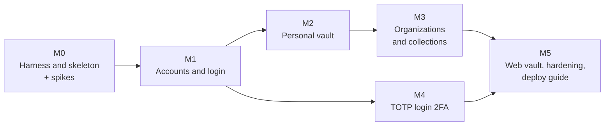

# 05. Delivery plan

## Summary

The MVP is built in six steps (M0 to M5), each made of small pull requests:

1. **M0:** the test machinery and a deployed "hello" Worker, plus small experiments to settle open questions.
2. **M1:** accounts and login.
3. **M2:** the personal vault.
4. **M3:** family sharing with organizations and collections.
5. **M4:** logging in with an authenticator-app code (TOTP).
6. **M5:** the web vault, hardening, and the deploy guide.

Every pull request starts with failing test scenarios, then adds the code that makes them pass. This design PR contains only documents.

## Milestones

M4 depends only on M1, so it can run in parallel with M2 and M3.

### M0. Walking skeleton and test harness

A deployed Worker that answers `GET /api/alive`, with the whole test machinery working around it.

Deliverables:

- Tooling from [09-tech-stack.md](09-tech-stack.md) and [ADR 0011](adr/0011-toolchain.md): TypeScript 6 strict, Node and npm, Vitest 5, `@cloudflare/vitest-plugin`, Drizzle, Biome, Oxlint (type-aware), Semgrep rules, knip, type-coverage, dependency-cruiser, gitleaks, zizmor, typos, CI.
- Scenario parser, printers for `sync of` and `stored vault of`, runner R1, and runner R2 over HTTPS.
- Scenarios for `alive`, `now`, `version`, `config`.
- Harness guard CI job (PR type vs paths, coverage matrix).
- CI checks from [08-cloudflare-practices.md](08-cloudflare-practices.md).
- Staging environment deployed from `main`.

Spikes, with written results in `docs/spikes/`:

| # | Question | Status |
|---|---|---|
| 1 | PBKDF2 (600,000 iterations) CPU cost: inline vs Durable Object | **Local result:** about 100 ms per hash, so not inline on Free. Still to do: hosted measurement on a Free account ([POC notes](spikes/2026-11-design-pocs.md)) |
| 2 | Rate Limiting binding on Free | open |
| 3 | Stryker with `@cloudflare/vitest-plugin` | open |
| 4 | Per-request D1 `meta` in the in-process runner | open |
| 5 | Vaultwarden container as oracle (R3) with shared scenario files | **Partly done:** container plus HTTPS recording proxy works |
| 6 | Bitwarden SDK live tests against a Worker | open |
| 7 | Registration shapes and "V2" accounts in current clients | **Partly done:** web vault 2026.10.1 recorded |
| 8 | Per-PR preview environments | open |
| 9 | Record the organization and TOTP flows from a real web vault | open (blocked by a web vault pop-up in the design-phase attempt) |
| 10 | TypeScript 7 support across the toolchain (Stryker, dependency-cruiser, knip, Drizzle) | open; start on 6.0. Oxlint already tracks 7 |
| 11 | Bundle size and cold-start CPU with Drizzle and Hono on the Free plan | open; fall back to plain SQL behind the same adapter if significant |
| 12 | Chanfana: does a generated OpenAPI spec help the endpoint coverage check enough to adopt it? | open |
| 13 | Bun as the local package manager and the `bun --bun vitest` launcher | **Local result:** both work; `bun test` cannot run Worker tests ([POC notes](spikes/2026-11-design-pocs.md#4-bun-and-linters)) |

Exit criteria: CI is green with all stages that exist; a red scenario can be written, seen failing, and fixed; spike results update the design and ADRs where they change a decision.

### M1. Accounts and login

Endpoints in [03-api-surface.md](03-api-surface.md#m1-accounts-and-login). Implements the per-account Durable Object ([ADR 0005](adr/0005-per-account-durable-object.md)) and tokens ([ADR 0006](adr/0006-token-signing.md)).

Exit criteria: the web vault and `bw` CLI can register (both payload shapes), log in, refresh, and log out against `wrangler dev` over HTTPS and staging. Password change invalidates old tokens. Enumeration and throttle scenarios pass. [THREAT_MODEL.md](../THREAT_MODEL.md) is reviewed against the implementation.

### M2. Personal vault

Endpoints in [03-api-surface.md](03-api-surface.md#m2-personal-vault).

Exit criteria: create, edit, trash, restore, delete, move, and import sync across two devices. `premium: true` is returned. Budget scenarios for sync and import pass. Property-based invariants pass.

### M3. Organizations and collections

Endpoints in [03-api-surface.md](03-api-surface.md#m3-organizations-and-collections), design in [ADR 0008](adr/0008-organizations.md).

Exit criteria: the family flow in the [acceptance criteria](01-scope.md#acceptance-criteria-for-the-mvp) works with the web vault and `bw` CLI. The organization access table passes and has been reviewed by a human. The organization property test passes. Revision-date write budget passes. The threat model gains organization actors.

### M4. TOTP login two-factor

Endpoints in [03-api-surface.md](03-api-surface.md#m4-login-two-factor-totp), design in [ADR 0009](adr/0009-totp.md).

Exit criteria: setup, login with code, recovery code, and remember device work with the web vault and `bw` CLI. RFC 6238 vector table passes. Replay and lockout scenarios pass.

### M5. Delivery and hardening

- Web vault served from the Worker at a pinned upstream version.
- Rate limits, cron cleanup.
- Browser end-to-end tests (Playwright) for the family flow and TOTP login.
- Compatibility matrix with exact client versions.
- Manual exploratory checklist.
- "Deploy to your own account" guide and a one-workflow GitHub Actions deploy.
- Nightly jobs (stages 7 to 9) running.

Exit criteria: all [MVP acceptance criteria](01-scope.md#acceptance-criteria-for-the-mvp) hold.

## PR slicing

Each PR is one of four types, which CI checks against changed paths (see [protecting the harness](04-testing-strategy.md#protecting-the-harness)):

| Type | May change |
|---|---|
| `feature` | `src/`, `specs/` |
| `refactor` | `src/` only |
| `coverage` | `specs/` only |
| `dsl` | `specs/`, `test/runner/` |

A PR for one endpoint group has at least these commits, in order: scenarios (red), implementation (green), optional refactor. A reviewer can check out the first commit and see the scenarios fail.

Target PR size: under about 400 changed lines, excluding generated files and scenario data.

## Branch and review rules

- `main` is protected: required checks are CI stages 1 to 5; one approving review; no force pushes.
- Conventional commit messages.
- A PR description states the type, the scenario ids added or changed, and the oracle result for new endpoints.

## Definition of done (every PR)

1. New behavior is described by scenarios or table rows, which failed before the change.
2. Unit tests exist for new domain rules, with properties where an invariant applies.
3. CI stages 1 to 5 pass; stage 6 shows no new surviving mutants in changed domain code, or each is explained.
4. New endpoints are checked against the oracle and the result is in the PR description.
5. Budgets for the touched endpoints are declared and pass.
6. Docs are updated if a decision changed, and an ADR is added for any new significant decision. Every document keeps its plain-English summary at the top.
7. No secrets, no vault data, no personal data in code, fixtures, or logs.

## Risks

| Risk | Mitigation |
|---|---|
| Durable Object hashing has a hidden cost or latency on Free | M0 spike 1 (hosted measurement); the port lets us swap the hasher without touching use cases |
| Organization access bug leaks items between family members | Reviewed access table, property test, oracle comparison, threat model section |
| Organization flow needs endpoints we have not recorded yet (billing, plans) | M0 spike 9 records the real flow before M3 |
| Bitwarden clients change API behavior | Pinned client versions; nightly contract job on latest; scenario per endpoint spelling |
| Oracle (Vaultwarden) differs from official Bitwarden | Triage each difference; prefer official docs and SDK tests |
| Stryker does not work with the Workers test plugin | Mutation testing at unit level only, plus recorded fault injection |
| D1 daily limits hit on Free | Budget tests; upgrade path documented |
| Durable Object quota (100,000 requests per day on Free) exhausted | At most two Durable Object calls per login; budget test; monitoring |
| TOTP brute force (only a million codes) | Per-account throttle in the Durable Object; lockout scenario |
| Security bug in a young project | Threat model, strict throttle, dependency audit, focused feature set; README says it is unaudited |
| Web vault license or redistribution questions | Open question 4; download a pinned upstream release at deploy time |
