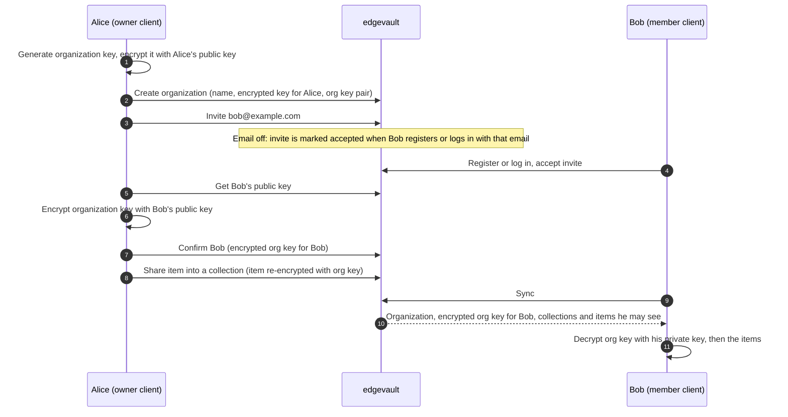
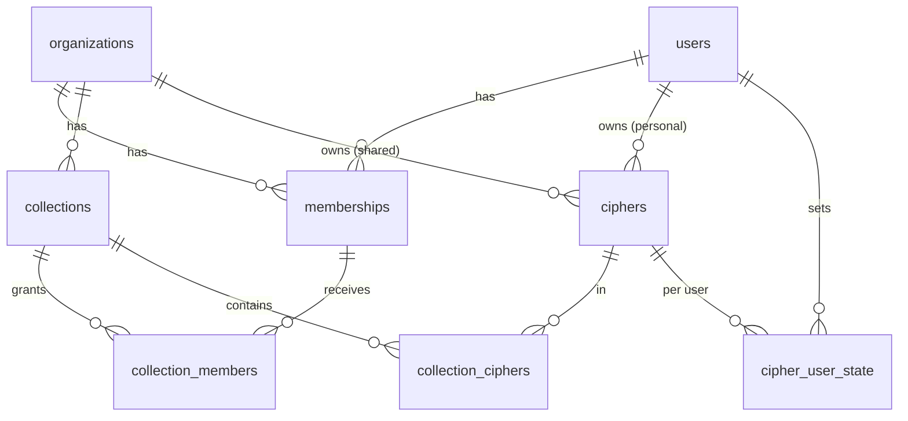

# ADR 0008: Organizations for families

Status: proposed, endpoint details to be confirmed with captured client traffic in M0

## Summary

A family shares passwords through a Bitwarden **organization**. One person creates it, invites the others, and confirms them. Shared items live in **collections**, and each member can be given access to some or all collections.

The server never sees the organization's key or any shared password. The clients encrypt everything. The server only stores ciphertext and decides **who may read or change which records**, so access checks on the server are the security boundary for sharing.

The MVP supports what a family needs and leaves out business features such as groups, policies, SSO, and account recovery.

## How it works

A member who was invited or accepted but not confirmed has no organization key and gets no items. Only confirmation gives them the key.

## Decision

### Roles and states

- **Membership states:** invited, accepted, confirmed, revoked.
- **Roles:** owner, admin, user. The "manager" or "custom" role is out of the MVP.
- **Collection access per member:** read-only, hide passwords, manage. A member can also have access to all collections.
- The clients enforce "hide passwords" on their side. The server enforces read-only and access to collections.

### Email

- Default: **no email.** An invite for an email address is marked accepted when a user with that email registers or logs in. The owner then confirms them. This is what Vaultwarden does when email is off, and it suits a family.
- Optional: email invites through Cloudflare Email Service. On Free it can only send to verified addresses in your own account; on Paid it can send to anyone.

### Data model (D1)

- `organizations(id, name, billing_email, public_key, encrypted_private_key, revision_date, created_at)`
- `memberships(id, organization_id, user_id NULL until accepted, email, status, role, access_all, encrypted_org_key NULL until confirmed, created_at)`
- `collections(id, organization_id, name /* EncString */, external_id)`
- `collection_members(collection_id, membership_id, read_only, hide_passwords, manage)`
- `collection_ciphers(collection_id, cipher_id)`
- `ciphers`: exactly one owner, either `user_id` or `organization_id` (a `CHECK` constraint)
- `cipher_user_state(cipher_id, user_id, folder_id, favorite)`: folders and favorites are personal even for shared items, as in Bitwarden

### Access rules (enforced on every request)

| Who | Can |
|---|---|
| Owner | Everything in the organization, including deleting it and managing admins |
| Admin | Manage members (not owners), collections, and all items |
| User | Read items in assigned collections; write them unless read-only |
| Accepted, not confirmed | See the organization name and that they are pending. No items, no collections, no key |
| Revoked | Nothing in that organization |

These rules are a **table of scenarios**: every role against every action, with the expected allow or deny. It is the most important test table in the project.

### Revision dates

Clients decide whether to sync by polling their revision date. A change to a shared item must bump the revision date of **every member who can see it**. For a family of about six people, this is a handful of extra writes per change. A budget test asserts it.

## Not in the MVP

Groups, policies, SSO, SCIM, directory sync, account recovery (admin password reset), organization API keys, event logs, the "manager" and custom roles, billing (the server reports a self-hosted family plan with no limits), and organization export beyond what the client builds itself.

## Consequences

- Sync becomes a join: personal items plus items in collections the user can see. Indexes on `collection_members(membership_id)` and `collection_ciphers(collection_id)` keep rows read near one per item.
- The access-rule table must be reviewed by a human; mistakes there leak data between family members.
- The web vault calls some billing and plan endpoints even for self-hosted servers. We return fixed values that unlock the features. The exact list comes from M0 traffic capture.

## Alternatives considered

- **No organizations, share by exporting:** what NodeWarden and warden-worker offer today; not enough for a family.
- **Full Bitwarden organization model:** too big for an MVP, and most of it is for businesses.
